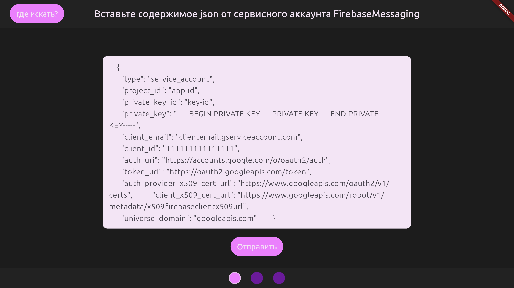
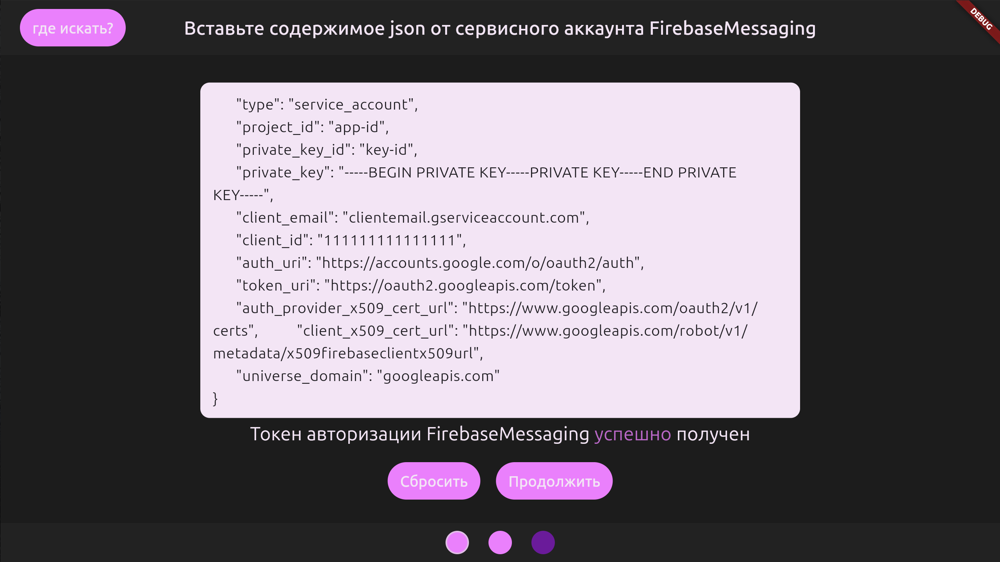
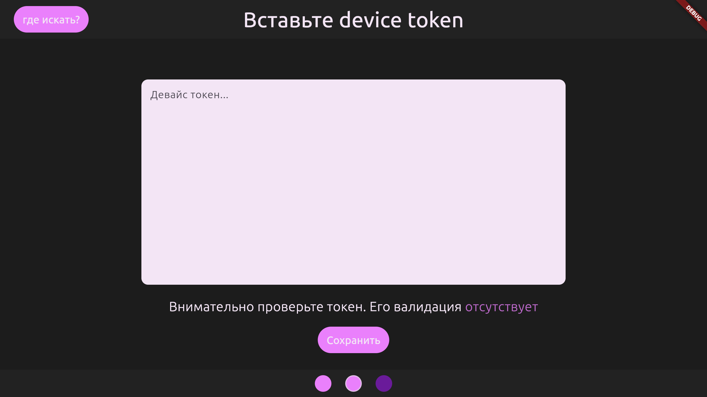
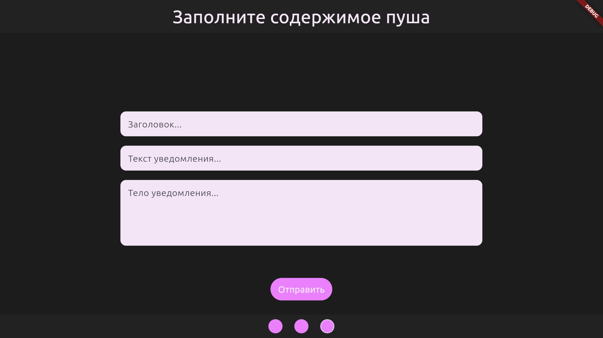
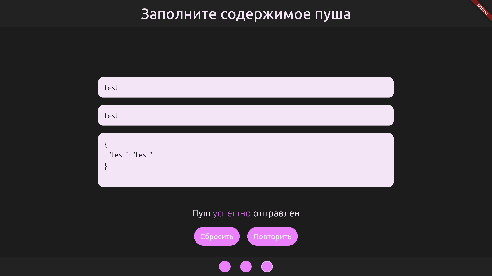

# push_by_token_tester

## Desktop push workbench (FCM / RuStore)

The original three-step FCM wizard is still available. Open **FCM / RuStore ·
новый отправитель** in the top bar for the independent push workbench. It sends
one message to one device, with either a notification or arbitrary string-valued
JSON data. No application-specific presets, endpoints, identifiers, credentials,
or business rules are included.

### Run

With Flutter installed:

```sh
flutter pub get
flutter run -d macos
# On a Linux desktop with Flutter's Linux toolchain:
flutter run -d linux
```

For a network-free demonstration of both screens:

```sh
flutter run -d macos -t lib/mock_main.dart
```

The workbench refuses to collect credentials or send messages in web builds.
Do not distribute service credentials in a web client. macOS release builds
include the outgoing-network sandbox entitlement.

### Send to a device

1. Choose **RuStore** or **FCM**. Changing the provider clears the form.
2. Enter a project ID and credentials **in the running desktop application**:
   RuStore takes a service token without the `Bearer ` prefix; FCM takes a Google
   service-account JSON for the project and obtains an OAuth access token.
3. Paste exactly one device push token belonging to that provider/project.
4. Choose **Data-only** or disable it and enter a notification title/body.
   For data-only, supply a nonempty JSON object with string values, for example
   `{"kind":"test","text":"Hello"}`. The workbench has no knowledge of your
   application's required payload fields or display rules.
5. Set Android TTL in seconds (1–2419200). Optionally enable either helper:
   - **UUID in data**: choose the field name your application recognizes.
     A missing value is generated. A manual repeat preserves it. **Новый тест**
     generates a new UUID only when this helper is enabled. Deduplication itself
     must be implemented by the receiving application.
   - **Unix expiry in data**: choose the field name your application recognizes.
     A missing value is set to current Unix seconds plus TTL. An existing value
     must be a future Unix timestamp within 28 days, encoded as a string. Before
     each attempt, Android TTL is capped to the remaining whole seconds. An
     expired payload cannot be sent; **Новый тест** refreshes the expiry.
6. Click **Отправить**. Only this button sends a request. After an attempt,
   payload editing is locked until **Новый тест**. **Повторить тот же payload**
   preserves its data, ID and expiry; the transport recalculates remaining TTL.

The complete request is limited to 4096 UTF-8 bytes. Data-only requests contain
neither `message.notification` nor `message.android.notification`. Reserved data
keys are rejected. Project IDs cannot change the fixed HTTPS destination:
[`vkpns.rustore.ru` API](https://www.rustore.ru/help/sdk/push-notifications/send-push-notifications)
or `fcm.googleapis.com`.

### Results and privacy

**API accepted** means only that the provider accepted the request. Confirm
delivery, display, foreground handling and deduplication on the target device
separately. The workbench cannot infer these from an HTTP response.

400/401/403/404/429 responses have separate diagnostics, including expired keys
and device tokens. Server errors, malformed success responses, redirects, network
failures and send timeouts are treated as unknown outcomes. There are no automatic
retries or redirects. If you retry manually after an unknown outcome, keep the
same application-recognized ID. Authorization and sending each have a 20-second
timeout. A timed-out authorization cannot trigger a later push request.

In the new workbench, credentials and recipient tokens are masked with no reveal
button, autocorrection or personalized input learning. They exist only in the
current form/request; there is no request history, persistence, analytics, or
logging of requests, responses or exceptions. **Очистить всё**, provider changes
and leaving the screen clear the form, including secret-field undo history.
Closing a managed Dart process is not a cryptographic memory-erasure guarantee;
the OS clipboard and external debugging tools are outside the app's control.
Use synthetic values for screenshots and tests. Do not put real credentials into
source files, examples, launch configurations, test fixtures or PR attachments.
The original wizard is retained as-is; use the new workbench for masked entry.

### Checks

```sh
flutter analyze
flutter test test/app_test.dart test/push_workbench_test.dart
flutter build macos --release
```

The explicit test entry points also execute all original wizard steps. The three
original helper files named `*_test.dart` are `part of 'app_test.dart'` without
their own `main`; an unqualified `flutter test` tries to load those helpers as
independent suites. Their source and existing tests have been preserved.

Validated with Flutter 3.47.4 / Dart 3.13.3 on macOS. HTTP tests use generated,
synthetic credentials and mock responses. A real provider/Android-device check
and a Linux build require separate verification; unit tests do not prove delivery.

## Original FCM wizard

An application that allows you to send a firebase push message on a device by its token, written with Dart/Flutter and Bloc architecture. It is fully working on Linux and Macos and covered with tests, so feel free to use it.

## Getting Started

There are **two build confings** available:

- **push_token_tester** that runs main.dart and uses real repositories.
- **test** that runs main_mock.dart and uses fake ones.

Screenshots are made with **test** build and using fake data. **Do not share your FCM credentials**
and device token. Better make a new service credentials, give them proper rights,
and delete them from the account after the job done.


1) Retreive service credentials of your Firebase project.





2) Get the device token.




3) Complete any data you want to send.




_TADA! If your device supports FCM, you got service credentials of an app that really exist in firebase and installed on the device and device token really belongs to the device, push should come to you just ok_
